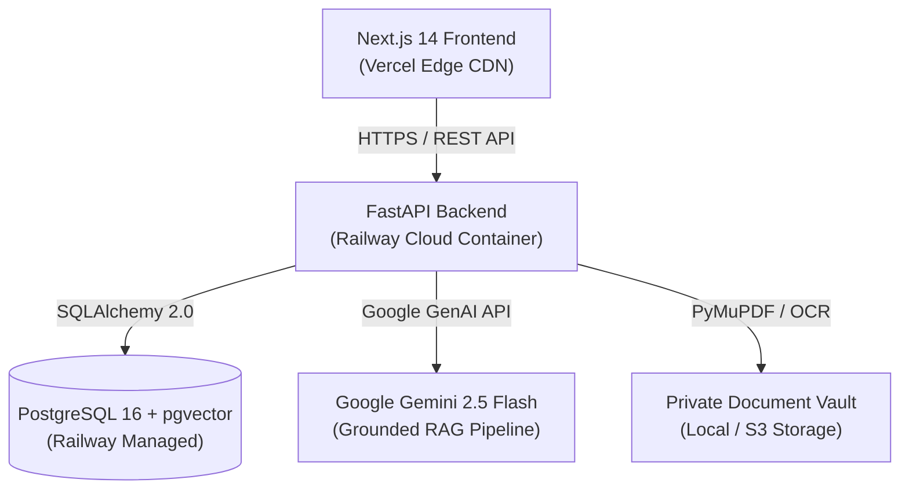

# AMIL — Indian Legal Intelligence Platform
### *Juris — Legal Intelligence & AI Counsel for India*

[](https://amil-legal.vercel.app)
[](https://amil-api-production.up.railway.app/api/v1/health)
[](https://amil-api-production.up.railway.app/docs)
[](https://www.indiacode.nic.in)
[](https://github.com/sjenijndjn)

---

## 🏛️ Executive Summary

**AMIL** is a comprehensive, production-grade Indian LegalTech SaaS platform and conversational AI counsel system custom-engineered for **Amil Bhatt**. Powered by **Juris — Legal Intelligence**, the platform provides verified statutory analysis, binding Supreme Court case law retrieval, intelligent document risk analysis, automated legal drafting, and task management.

> **Core Product Principle:**  
> *"Every important legal answer must be traceable to an authentic, authoritative legal source."*  
> No hallucinations. Strict distinction between historical colonial statutes (IPC, CrPC, Indian Evidence Act) and post-July 1, 2024 Sanhitas (Bharatiya Nyaya Sanhita, Bharatiya Nagarik Suraksha Sanhita, Bharatiya Sakshya Adhiniyam).

---

## 🔗 Live Deployments & Official Links

| Service | Environment / Tool | Live URL |
| :--- | :--- | :--- |
| **Production Web App** | Vercel (Edge CDN + Next.js 14) | [https://amil-legal.vercel.app](https://amil-legal.vercel.app) |
| **FastAPI Backend API** | Railway Cloud (Docker Container) | [https://amil-api-production.up.railway.app](https://amil-api-production.up.railway.app) |
| **Live API Health Check** | PostgreSQL + Gemini RAG Status | [https://amil-api-production.up.railway.app/api/v1/health](https://amil-api-production.up.railway.app/api/v1/health) |
| **Interactive API Docs** | Swagger UI (OpenAPI 3.1) | [https://amil-api-production.up.railway.app/docs](https://amil-api-production.up.railway.app/docs) |
| **ReDoc API Reference** | ReDoc Clean Documentation | [https://amil-api-production.up.railway.app/redoc](https://amil-api-production.up.railway.app/redoc) |
| **GitHub Source Code** | Monorepo (`frontend` + `backend`) | [https://github.com/sjenijndjn/amil-legal](https://github.com/sjenijndjn/amil-legal) |
| **Product Owner Profile** | GitHub Account | [https://github.com/sjenijndjn](https://github.com/sjenijndjn) |

---

## ⚖️ What This Application Can Do

AMIL is designed with 15 integrated modules tailored to Indian legal research, litigation, and transactional workflows:

### 1. Juris — Conversational Indian Legal AI (`/juris`)
* **7-Part Structured Legal Answer:** Every query returns a standardized legal opinion containing:
  1. *Legal Issue Summary* (core question framed under Indian statutory law).
  2. *Applicable Acts & Sections* (substantive & procedural provisions).
  3. *Relevant Case Law* (Supreme Court and High Court precedents).
  4. *Plain English Explanation* (client-ready breakdown).
  5. *Procedural Steps & Practical Takeaways* (actionable litigation strategy).
  6. *Risks, Limitations & Ambiguities* (state variations, exceptions, forum limitations).
  7. *Verification & Legal Disclaimer Footer* (corpus timestamps and statutory savings clauses).
* **2024 Sanhita Transition Intelligence:** Distinguishes between acts committed prior to July 1, 2024 (governed by IPC 1860, CrPC 1973, IEA 1872) and on/after July 1, 2024 (governed by BNS 2023, BNSS 2023, BSA 2023).
* **Multi-Turn Persistent Sessions:** Every chat session is stored in PostgreSQL, allowing continuous refinement and context retention.
* **Flexible Response Modes:** Supports `Short`, `Standard`, `Detailed`, and full `Research Mode`.

### 2. Unified Legal Research Engine (`/research`)
* **Hybrid Search Engine:** Combines keyword search with 768-dimensional semantic embeddings (`pgvector`) to find relevant statutes and judgments even when natural legal phrasing varies.
* **Filter Controls:** Filter by jurisdiction (Supreme Court, High Courts, Tribunals), subject matter (Criminal, Constitutional, Commercial, Data Privacy, Arbitration), and date ranges.

### 3. Bare Acts Statutory Library (`/bare-acts`)
* **Complete Statutory Index:** Includes full text and indexed sections of:
  * *The Bharatiya Nyaya Sanhita, 2023 (BNS)*
  * *The Bharatiya Nagarik Suraksha Sanhita, 2023 (BNSS)*
  * *The Bharatiya Sakshya Adhiniyam, 2023 (BSA)*
  * *The Constitution of India (1950)*
  * *The Digital Personal Data Protection Act, 2023 (DPDP Act)*
  * *The Information Technology Act, 2000 (IT Act)*
  * *The Indian Contract Act, 1872*
  * *The Companies Act, 2013*
  * *The Consumer Protection Act, 2019*
  * *The Arbitration and Conciliation Act, 1996*
  * *Historical Codes (IPC 1860, CrPC 1973, Indian Evidence Act 1872)*
* **Section-to-Section Comparative Tables:** Instantly view side-by-side equivalents (e.g., Section 318 BNS ↔ Section 420 IPC; Section 63 BSA ↔ Section 65B IEA; Section 35 BNSS ↔ Section 41A CrPC).

### 4. Judicial Precedents & Case Law (`/case-laws`)
* **Binding Precedent Indicators:** Identifies the precedential authority of decisions:
  * 🟢 `BINDING` (Supreme Court Constitution/Division Benches).
  * 🔵 `PERSUASIVE` (High Court rulings in relevant jurisdictions).
  * 🔴 `OVERRULED` (Automatic warnings to prevent citing bad law).
  * 🟡 `DISTINGUISHED` / `PENDING_VERIFICATION`.
* **Standardized Citations:** Displays both official Supreme Court neutral citations (`INSC`) and law report citations (`SCC`, `AIR`).
* **Headnotes & Ratio Decidendi:** Highlights governing legal principles and key judgment paragraphs.

### 5. Document Intelligence & OCR Studio (`/documents`)
* **Multi-Format Processing:** Ingests PDF, Word (`.docx`), and text agreements with PyMuPDF and Tesseract OCR.
* **Clause Extraction:** Automatically categorizes clauses into Governing Law, Dispute Resolution, Indemnity, Liability Super-Caps, and Termination.
* **Risk & Non-Compliance Flags:** Flags one-sided arbitration clauses (e.g. unilateral appointment contrary to *CORE (2024 INSC 857)*) and uncapped liability provisions.
* **Document Q&A:** Ask questions directly against uploaded agreements with page citations.
* **Document Comparison:** Compares two contracts side-by-side to highlight additions, deletions, and risk changes.

### 6. Legal Drafting Studio (`/drafting`)
* **Fact-Driven Legal Drafting:** Scaffolds structured legal documents grounded in user-provided fact sheets and verified citations.
* **Supported Draft Types:**
  1. *Statutory Legal Notices* (e.g., Section 73 Contract Act, Section 138 Negotiable Instruments Act).
  2. *Court Applications* (e.g., Section 482 BNSS / Anticipatory Bail).
  3. *Consumer & Police Complaints* (Section 173 BNSS e-FIR).
  4. *Legal Representations & Grievances*.
  5. *Commercial Agreements & NDAs*.
  6. *Affidavits & Verifications*.
  7. *Legal Opinions & Memoranda*.
  8. *Formal Legal Correspondence*.
* **Export Capability:** Export drafts with formal formatting into Microsoft Word (`.docx`) and Adobe PDF (`.pdf`).
* **Revision History:** Full version tracking (`v1`, `v2`, `v3`) with automated change logs.

### 7. My Legal Library (`/library`)
* Personal repository for saved statutes, sections, judicial precedents, and custom notes.
* Organize research into colored folders with custom tags and rapid search.

### 8. Legal Tasks & Reminders (`/tasks`)
* Track statutory limitation deadlines, court appearances, and filing dates.
* Priority levels (`URGENT`, `HIGH`, `MEDIUM`, `LOW`) with reminder scheduling and calendar view.

### 9. Executive Dashboard (`/dashboard`)
* Personalized owner dashboard (`"Welcome back, Amil."`) with real-time statistics, recent consultations, pinned notes, and pending deadlines.

### 10. Privacy & DPDP Compliance (`/profile` & `/settings`)
* **Digital Personal Data Protection (DPDP) Act, 2023 Compliance:** Explicit AI processing consent toggle for confidential client documents.
* **Right to Erasure:** One-click data purge endpoint to completely erase all personal documents, drafts, notes, and session history.
* **Themes:** Default **Midnight Navy + Gold** (`#0B1220` / `#D6B66D`) aesthetic with light mode support.

---

## 🛠️ Architecture & Tech Stack



### Frontend
* **Framework:** Next.js 14.2.18 (App Router, Server & Client Components)
* **Language:** TypeScript 5.6 (Strict Mode)
* **Styling:** Tailwind CSS 3.4 with custom legal typography (*Manrope*, *Inter*, *IBM Plex Mono*)
* **UI Components:** Custom shadcn/ui primitives with Radix UI accessibility
* **State & Sync:** Dual-write persistence (PostgreSQL REST API + resilient LocalStorage caching)
* **Icons:** Lucide React

### Backend
* **Framework:** Python 3.11 + FastAPI (Async REST API)
* **ORM & Migrations:** SQLAlchemy 2.0 + Alembic
* **Database:** PostgreSQL 16 with `pgvector` extension for semantic vector embeddings
* **Security & Auth:** Argon2id password hashing, rotating JWT Access & Refresh Tokens
* **Document Processing:** PyMuPDF (`fitz`), `python-docx`, Pillow, Tesseract OCR
* **Production Server:** Gunicorn + Uvicorn Worker Processors

### AI & Legal RAG Pipeline
* **LLM Engine:** Google Gemini 2.5 Flash (`gemini-2.5-flash`)
* **Grounding Engine:** Verified Indian Legal Corpus (India Code & Supreme Court e-SCR)
* **Citation Validator:** Pre-generation statutory checker preventing hallucinated sections or overruled citations

---

## 🚀 Local Development Setup

### Prerequisites
* **Node.js:** v18+ (v20+ recommended)
* **Python:** v3.11+
* **PostgreSQL:** v15+ (with `pgvector` extension) or SQLite (automatic local fallback)
* **Google Gemini API Key:** [Google AI Studio](https://aistudio.google.com/)

### 1. Clone the Repository
```bash
git clone https://github.com/sjenijndjn/amil-legal.git
cd amil-legal
```

### 2. Configure Backend
```bash
cd backend

# Create virtual environment
python3 -m venv .venv
source .venv/bin/activate

# Install dependencies
pip install -r requirements.txt

# Configure environment variables
cp .env.example .env
# Edit .env with your DATABASE_URL and GEMINI_API_KEY

# Run database migrations
alembic upgrade head

# Start FastAPI server
uvicorn app.main:app --reload --port 8000
```
Backend API will be available at `http://localhost:8000`.  
Swagger documentation at `http://localhost:8000/docs`.

### 3. Configure Frontend
```bash
cd ../frontend

# Install dependencies
npm install

# Configure environment variables
cp .env.example .env.local

# Run Next.js development server
npm run dev
```
Open `http://localhost:3000` in your browser.

---

## 🧪 Testing Suites

```bash
# Run backend test suite (Auth, Isolation, Grounded RAG, OCR)
cd backend
pytest -v

# Run frontend build check and type validation
cd ../frontend
npm run build
```

---

## 👤 Product Owner & Credits

* **Product Owner & Creator:** **Amil Bhatt**
* **Email:** `amil@amillegal.in`
* **GitHub:** [@sjenijndjn](https://github.com/sjenijndjn)
* **Repository:** [sjenijndjn/amil-legal](https://github.com/sjenijndjn/amil-legal)
* **Live Application:** [https://amil-legal.vercel.app](https://amil-legal.vercel.app)

---

*Disclaimer: AMIL and Juris provide legal research intelligence, statutory cross-referencing, and automated drafting assistance for informational and professional productivity purposes. All court filings, pleadings, and legal advice should be finalized by an Advocate admitted to practice before the Bar Council.*
