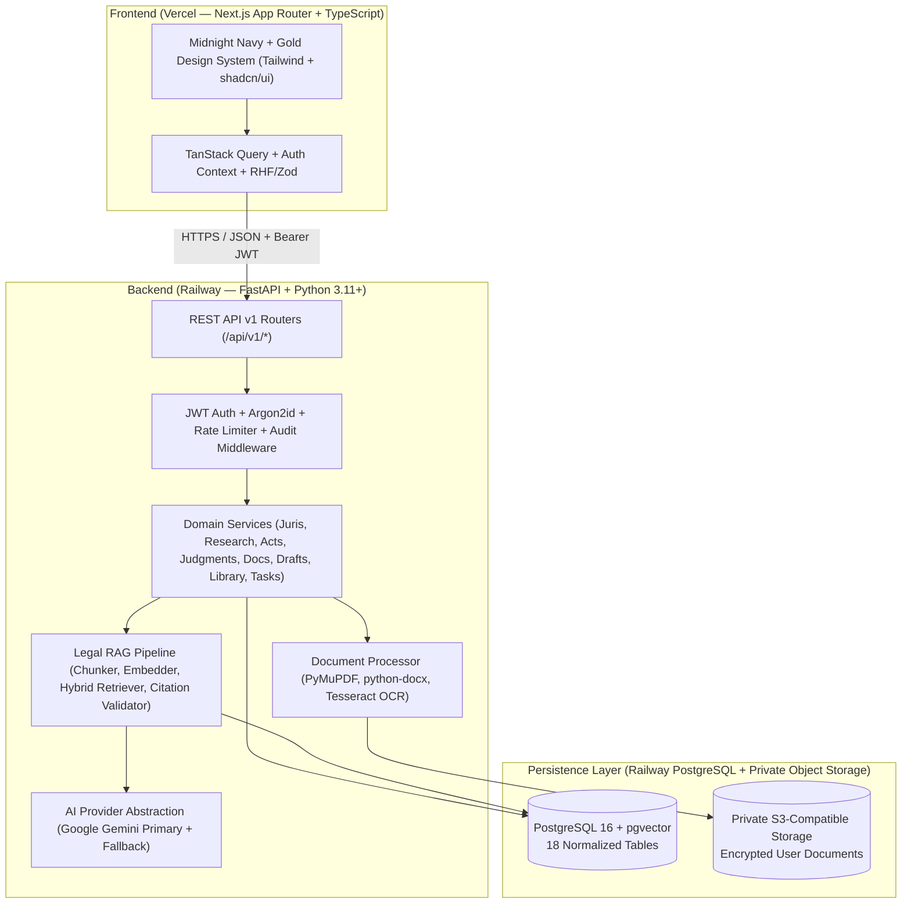
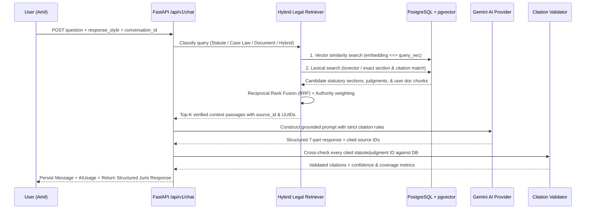

# AMIL Legal Intelligence Platform — Product Specification & Technical Architecture

- **Product Owner:** Amil Bhatt
- **Working Brand:** AMIL (Configurable via `NEXT_PUBLIC_APP_NAME` & backend config)
- **AI Assistant:** Juris — Legal Intelligence
- **Primary Jurisdiction:** India
- **Core Product Principle:** *Every important legal answer must be traceable to a reliable legal source.*

---

## 1. Detailed Product Specification

### 1.1 Vision & Scope
AMIL is a personalized Indian LegalTech SaaS workspace optimized initially for Amil Bhatt's legal research, statutory analysis, case law tracking, document intelligence, legal drafting, and productivity, architected with strict multi-tenant user isolation (`user_id` ownership and role-based access control) to scale seamlessly to lawyers, law students, and legal organizations.

### 1.2 Core Functional Modules
1. **Personalized Dashboard (`/dashboard`)**
   - Greets owner dynamically (`"Welcome back, Amil."` based on user profile display name).
   - Quick Juris AI omnibox with response-length selector (`Short`, `Standard`, `Detailed`, `Research Mode`).
   - Live database-driven metrics & feeds: recent conversations, recent legal research queries, saved judgments, saved statutory provisions, uploaded documents, active drafts, upcoming tasks/reminders, and quick action shortcuts.
   - Clean, informative empty states when collections are empty.

2. **Ask Juris — Conversational Legal Intelligence (`/juris`)**
   - Multi-turn conversational workspace with history, search, rename, delete, and Markdown/JSON export.
   - Enforces the **7-Part Structured Legal Answer Format**:
     1. **Direct Answer**
     2. **Applicable Legal Provisions**
     3. **Relevant Judgments**
     4. **Legal Reasoning**
     5. **Source References** (with clickable citation cards and source metadata)
     6. **Important Limitations & Uncertainty**
     7. **Verification Date & Disclaimer**
   - Supports saving any answer directly into **My Legal Library** and copying formatted citations.

3. **Legal Research Engine (`/research`)**
   - Unified hybrid search (semantic `pgvector` + PostgreSQL full-text `tsvector` + metadata filters) across legislation, statutory sections, and judgments.
   - Filtering by court, date range, legal subject/topic, and source repository (India Code, Supreme Court of India / eSCR, High Courts, eCourts Services).
   - Extensible ingestion pipeline supporting official repository imports and manual verified uploads without unauthorized scraping.

4. **Bare Act Library (`/bare-acts`)**
   - Structured hierarchical reader (Act → Part/Chapter → Section) with commencement date, effective date, source authority, and amendment notes.
   - Explicit separation between **Current Enacted Legislation** (e.g., *Bharatiya Nyaya Sanhita, 2023 (BNS)*, *Bharatiya Nagarik Suraksha Sanhita, 2023 (BNSS)*, *Bharatiya Sakshya Adhiniyam, 2023 (BSA)*, *Constitution of India*, *Information Technology Act, 2000*, *Consumer Protection Act, 2019*, *Indian Contract Act, 1872*, *Companies Act, 2013*, *DPDP Act, 2023*) and **Historical Legislation** (e.g., *Indian Penal Code, 1860*, *Code of Criminal Procedure, 1973*, *Indian Evidence Act, 1872*) with side-by-side comparison mapping where verified.
   - Section-level bookmarking and private user annotations.

5. **Case Law Research (`/case-laws`)**
   - Search and filter judgments by case title, neutral/reporter citation, court, bench/judges, decision date, and legal issue tags.
   - Precedent status indicators:
     - `BINDING` (Binding Precedent)
     - `PERSUASIVE` (Persuasive Precedent)
     - `DISTINGUISHED` (Distinguished)
     - `OVERRULED` (Overruled)
     - `PENDING_VERIFICATION` (Default until subsequent treatment is verified)
   - Relevant paragraph extraction, ratio decidendi summary, source verification links, bookmarking, and private notes.

6. **Document Intelligence (`/documents`)**
   - Secure upload for `PDF`, `DOCX`, and `TXT` files with MIME/magic-byte validation and size limits.
   - Explicit **AI Processing Consent Gate** prior to sending private document text to external LLM APIs.
   - Text extraction via `PyMuPDF` (`fitz`), `python-docx`, and `pytesseract` OCR fallback for scanned PDFs.
   - Automated structured analysis: Executive Summary, Extracted Parties/Names & Dates, Key Clauses, Legal Obligations, Deadlines, and Risk Flags.
   - Document-scoped RAG Q&A citing exact page/chunk numbers, plus side-by-side Document Comparison and exportable analysis reports.

7. **Drafting Studio (`/drafting`)**
   - Structured legal drafting workspace for Legal Notices, Applications, Complaints, Representations, Agreements, Affidavits, Legal Research Memoranda, and Correspondence.
   - Fact-sheet input form (never fabricates parties, facts, dates, or evidence), AI-assisted clause drafting, verified citation insertion, version history, live preview, and export to `.docx` and `.pdf`.
   - Mandatory banner marking outputs as `AI-ASSISTED DRAFT — REQUIRES HUMAN LEGAL REVIEW`.

8. **My Legal Library (`/library`)**
   - Personal knowledge repository organizing saved Acts, bookmarked sections, saved judgments, saved Juris answers, uploaded documents, and personal notes.
   - Custom user folders, color-coded tags, full-text filter, and sorting.

9. **Research History (`/history`)**
   - Chronological audit and resumption log of past search queries, Juris consultations, and viewed statutory/case sources.

10. **Tasks & Reminders (`/tasks`)**
    - Legal research tasks, deadline tracking, case reminders, priority levels (`LOW`, `MEDIUM`, `HIGH`, `URGENT`), status workflow (`TODO`, `IN_PROGRESS`, `COMPLETED`), and interactive monthly calendar view.
    - Explicit notice that personal reminders are internal productivity entries and not official eCourts hearing notifications.

---

## 2. Complete Technical Architecture



---

## 3. Monorepo Directory Structure

```text
amil-legal/
├── frontend/
│   ├── app/
│   │   ├── (auth)/
│   │   │   ├── login/page.tsx
│   │   │   └── register/page.tsx
│   │   ├── (workspace)/
│   │   │   ├── layout.tsx
│   │   │   ├── dashboard/page.tsx
│   │   │   ├── juris/page.tsx
│   │   │   ├── research/page.tsx
│   │   │   ├── bare-acts/page.tsx
│   │   │   ├── case-laws/page.tsx
│   │   │   ├── documents/page.tsx
│   │   │   ├── drafting/page.tsx
│   │   │   ├── library/page.tsx
│   │   │   ├── history/page.tsx
│   │   │   ├── tasks/page.tsx
│   │   │   ├── profile/page.tsx
│   │   │   ├── settings/page.tsx
│   │   │   └── help/page.tsx
│   │   ├── layout.tsx
│   │   └── page.tsx
│   ├── components/
│   │   ├── layout/ (Sidebar, Header, MobileNav, UserMenu)
│   │   ├── ui/ (Button, Card, Input, Badge, Modal, Skeleton, Toast, Tabs, Select)
│   │   ├── juris/ (ChatInterface, StructuredAnswerCard, CitationCard, SourcePanel)
│   │   ├── documents/ (DocumentUploader, AnalysisViewer, DocumentComparator)
│   │   └── drafting/ (DraftEditor, TemplateSelector, CitationInserter)
│   ├── features/
│   ├── hooks/
│   ├── lib/ (api.ts, auth.ts, brand.ts, types.ts, utils.ts)
│   ├── styles/ (globals.css)
│   ├── public/
│   └── tests/
├── backend/
│   ├── app/
│   │   ├── api/v1/ (auth, profile, juris, research, acts, judgments, documents, library, drafts, tasks, health)
│   │   ├── core/ (config, security, exceptions, rate_limit, logging)
│   │   ├── models/ (18 SQLAlchemy 2.0 ORM models)
│   │   ├── schemas/ (Pydantic v2 request/response schemas)
│   │   ├── services/ (business logic & audit logging)
│   │   ├── ai/ (provider abstraction, gemini_provider, prompts, rag_pipeline, citation_validator)
│   │   ├── legal_research/ (seed_corpus, hybrid_search, ingestion)
│   │   ├── documents/ (extractor, ocr, analyzer, storage)
│   │   ├── database/ (session, base, init_db)
│   │   └── main.py
│   ├── alembic/
│   ├── tests/
│   └── requirements.txt
├── docs/
│   ├── architecture.md
│   ├── database.md
│   ├── api.md
│   ├── security.md
│   └── deployment.md
├── .env.example
├── .gitignore
└── README.md
```

---

## 4. UI Design System ("Midnight Navy + Gold")

### 4.1 Color Tokens
| Token | Hex | Usage |
| :--- | :--- | :--- |
| `--bg-primary` | `#0B1220` | Root workspace canvas background |
| `--bg-secondary` | `#111C2E` | Sidebar, header, secondary panels |
| `--bg-card` | `#162237` | Elevated cards, dialogs, input surfaces |
| `--accent-gold` | `#D6B66D` | Primary interactive accent, active borders, citation highlights |
| `--text-primary` | `#F5F3EE` | High-contrast warm ivory text |
| `--text-secondary` | `#A3ADBC` | Muted slate labels, metadata, timestamps |
| `--border-subtle` | `#26344A` | Hairline structural dividers and card borders |
| `--status-success` | `#3BAA83` | Verified source badge, active statute, completed task |
| `--status-error` | `#E36D70` | Overruled precedent alert, risk flag, error state |

### 4.2 Typography
- **Headings (`--font-manrope`):** `Manrope` (600/700 weight, tight tracking `-0.02em`)
- **Body (`--font-inter`):** `Inter` (400/500 weight, comfortable reading line-height `1.65` for statutory & judgment text)
- **Citations & Technical IDs (`--font-mono`):** `IBM Plex Mono` (400/500 weight for section numbers, neutral citations like `2023 INSC 842`, SHA-256 hashes, and effective dates)

---

## 5. RAG (Retrieval-Augmented Generation) Architecture



### Key Safeguards in the RAG Pipeline
1. **Zero Hallucination Tolerance:** The system prompt and post-generation `CitationValidator` verify that every cited Act section or judgment citation exists in the retrieved context or database corpus. Any unverified reference is stripped or flagged as `UNVERIFIED_EXTERNAL_REFERENCE`.
2. **Temporal Awareness (IPC/CrPC/IEA vs BNS/BNSS/BSA):** Queries involving criminal law automatically retrieve effective-date metadata (July 1, 2024 transition) so Juris distinguishes between offenses/proceedings governed by BNS/BNSS/BSA 2023 and historical matters under IPC 1860 / CrPC 1973 / IEA 1872.
3. **Abstention on Insufficient Coverage:** When retrieval confidence falls below threshold or no matching source exists in the authorized corpus, Juris explicitly states the coverage limitation rather than guessing.
