# AMIL Legal Intelligence Platform — Database Architecture & ER Specification

## 1. Entity-Relationship Diagram (Mermaid)

```mermaid
erDiagram
    users ||--o| profiles : "has one"
    users ||--o{ conversations : "owns"
    users ||--o{ documents : "uploads"
    users ||--o{ notes : "authors"
    users ||--o{ bookmarks : "saves"
    users ||--o{ folders : "organizes"
    users ||--o{ drafts : "creates"
    users ||--o{ tasks : "tracks"
    users ||--o{ audit_logs : "generates"
    users ||--o{ ai_usage : "consumes"

    conversations ||--o{ messages : "contains"
    legal_sources ||--o{ legal_acts : "publishes"
    legal_sources ||--o{ judgments : "publishes"
    legal_acts ||--o{ legal_sections : "comprises"
    judgments ||--o{ citations : "cites_or_cited_by"
    documents ||--o{ document_chunks : "indexed_into"
    folders ||--o{ bookmarks : "groups"
    folders ||--o{ notes : "groups"

    users {
        uuid id PK
        string email UK
        string password_hash
        boolean is_active
        boolean is_verified
        string role
        string refresh_token_hash
        timestamp created_at
        timestamp updated_at
    }

    profiles {
        uuid id PK
        uuid user_id FK, UK
        string display_name
        string avatar_url
        string preferred_theme
        string preferred_language
        string ai_response_style
        jsonb research_preferences
        jsonb saved_legal_topics
        jsonb workspace_settings
        boolean ai_document_consent
        timestamp created_at
        timestamp updated_at
    }

    conversations {
        uuid id PK
        uuid user_id FK
        string title
        string response_mode
        boolean is_pinned
        timestamp created_at
        timestamp updated_at
    }

    messages {
        uuid id PK
        uuid conversation_id FK
        uuid user_id FK
        string role
        text content
        jsonb structured_sections
        jsonb cited_sources
        float confidence_score
        string coverage_status
        timestamp created_at
    }

    legal_sources {
        uuid id PK
        string code UK
        string name
        string source_type
        string jurisdiction
        string official_url
        boolean is_verified_repository
        timestamp last_synced_at
        timestamp created_at
    }

    legal_acts {
        uuid id PK
        uuid source_id FK
        string title
        string short_title
        string act_number
        integer enactment_year
        date enactment_date
        date commencement_date
        date effective_date
        string status
        string replaces_act_code
        string replaced_by_act_code
        string subject_category
        text preamble
        jsonb amendment_history
        timestamp created_at
        timestamp updated_at
    }

    legal_sections {
        uuid id PK
        uuid act_id FK
        string part_number
        string chapter_number
        string chapter_title
        string section_number
        string section_title
        text statutory_text
        text amendment_notes
        date effective_date
        string corresponding_historical_section
        vector embedding
        timestamp created_at
        timestamp updated_at
    }

    judgments {
        uuid id PK
        uuid source_id FK
        string case_title
        string neutral_citation UK
        jsonb equivalent_citations
        string court
        string bench_type
        jsonb judges
        date decision_date
        string subject_matter
        jsonb legal_issues
        text headnote_summary
        text ratio_decidendi
        jsonb key_paragraphs
        text full_text_excerpt
        string precedent_status
        string verification_notes
        string official_source_url
        vector embedding
        timestamp created_at
        timestamp updated_at
    }

    citations {
        uuid id PK
        uuid citing_judgment_id FK
        uuid cited_judgment_id FK
        uuid cited_section_id FK
        string citation_text
        string treatment_type
        text context_excerpt
        boolean is_verified
        timestamp created_at
    }

    documents {
        uuid id PK
        uuid user_id FK
        uuid folder_id FK
        string title
        string original_filename
        string mime_type
        bigint file_size_bytes
        string sha256_hash
        string storage_key UK
        integer page_count
        boolean ocr_applied
        boolean ai_consent_granted
        string processing_status
        jsonb analysis_result
        timestamp created_at
        timestamp updated_at
    }

    document_chunks {
        uuid id PK
        uuid document_id FK
        uuid user_id FK
        integer chunk_index
        integer page_number
        string section_heading
        text content
        vector embedding
        timestamp created_at
    }

    folders {
        uuid id PK
        uuid user_id FK
        uuid parent_id FK
        string name
        string color_hex
        string description
        timestamp created_at
        timestamp updated_at
    }

    bookmarks {
        uuid id PK
        uuid user_id FK
        uuid folder_id FK
        string item_type
        uuid target_id
        string title
        text excerpt
        jsonb tags
        timestamp created_at
    }

    notes {
        uuid id PK
        uuid user_id FK
        uuid folder_id FK
        string title
        text content
        string linked_entity_type
        uuid linked_entity_id
        jsonb tags
        boolean is_pinned
        timestamp created_at
        timestamp updated_at
    }

    drafts {
        uuid id PK
        uuid user_id FK
        string title
        string draft_type
        jsonb user_facts
        text content_markdown
        jsonb cited_references
        integer version
        jsonb version_history
        string status
        timestamp created_at
        timestamp updated_at
    }

    tasks {
        uuid id PK
        uuid user_id FK
        string title
        text description
        string task_type
        string priority
        string status
        timestamp due_at
        timestamp reminder_at
        string linked_entity_type
        uuid linked_entity_id
        timestamp completed_at
        timestamp created_at
        timestamp updated_at
    }

    audit_logs {
        uuid id PK
        uuid user_id FK
        string action
        string resource_type
        string resource_id
        string ip_address
        string user_agent
        jsonb metadata_json
        timestamp created_at
    }

    ai_usage {
        uuid id PK
        uuid user_id FK
        string provider
        string model_name
        string operation_type
        integer prompt_tokens
        integer completion_tokens
        integer total_tokens
        integer latency_ms
        boolean success
        timestamp created_at
    }
```

---

## 2. Detailed Relational & Vector Schema Specification

### 2.1 Core Design Principles
1. **UUID v4 Primary Keys:** Every table uses `UUID` primary keys to prevent enumeration attacks and support distributed ingestion.
2. **Strict Tenant Ownership:** Every user-owned table (`profiles`, `conversations`, `messages`, `documents`, `document_chunks`, `notes`, `bookmarks`, `folders`, `drafts`, `tasks`, `audit_logs`, `ai_usage`) includes an indexed `user_id` foreign key with `ON DELETE CASCADE`, enforced at the query layer.
3. **Externalized Binary Storage:** `documents` never stores raw file bytes in PostgreSQL; instead, it stores `storage_key` pointing to private object storage, plus `sha256_hash`, `mime_type`, and `file_size_bytes`.
4. **Vector Retrieval (`pgvector`):** `legal_sections`, `judgments`, and `document_chunks` include 768-dimensional embedding columns (`Vector(768)`) compatible with Google Gemini `text-embedding-004`, with HNSW/IVFFlat cosine indexes in PostgreSQL and graceful fallback for local test suites.

### 2.2 Table-by-Table Indexes & Constraints
- **`users`**: `UNIQUE(email)`, `INDEX(email)`, `INDEX(is_active)`
- **`profiles`**: `UNIQUE(user_id)`, foreign key `user_id -> users.id ON DELETE CASCADE`
- **`conversations`**: `INDEX(user_id, updated_at DESC)`
- **`messages`**: `INDEX(conversation_id, created_at ASC)`, `INDEX(user_id)`
- **`legal_sources`**: `UNIQUE(code)` (e.g., `INDIA_CODE`, `SCI_ESCR`, `ECOURTS`)
- **`legal_acts`**: `INDEX(short_title)`, `INDEX(status)`, `INDEX(subject_category)`, `UNIQUE(act_number, enactment_year, title)`
- **`legal_sections`**: `INDEX(act_id, section_number)`, `UNIQUE(act_id, section_number)`, HNSW vector index on `embedding`
- **`judgments`**: `UNIQUE(neutral_citation)`, `INDEX(court, decision_date DESC)`, `INDEX(precedent_status)`, HNSW vector index on `embedding`
- **`citations`**: `INDEX(citing_judgment_id)`, `INDEX(cited_judgment_id)`, `INDEX(cited_section_id)`
- **`documents`**: `UNIQUE(storage_key)`, `INDEX(user_id, created_at DESC)`, `INDEX(sha256_hash)`
- **`document_chunks`**: `INDEX(document_id, chunk_index)`, `INDEX(user_id)`, HNSW vector index on `embedding`
- **`folders`**: `INDEX(user_id, parent_id)`, `UNIQUE(user_id, name, parent_id)`
- **`bookmarks`**: `INDEX(user_id, item_type)`, `UNIQUE(user_id, item_type, target_id)`
- **`notes`**: `INDEX(user_id, updated_at DESC)`, `INDEX(linked_entity_type, linked_entity_id)`
- **`drafts`**: `INDEX(user_id, draft_type, updated_at DESC)`
- **`tasks`**: `INDEX(user_id, status, due_at ASC)`
- **`audit_logs`**: `INDEX(user_id, created_at DESC)`, `INDEX(action, created_at DESC)`
- **`ai_usage`**: `INDEX(user_id, created_at DESC)`, `INDEX(provider, operation_type)`
