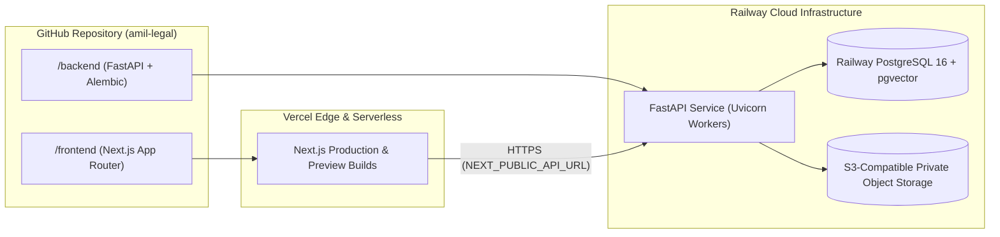

# AMIL Legal Intelligence Platform — Deployment Architecture (Vercel + Railway)

## 1. Topology Overview



---

## 2. Frontend Deployment on Vercel (`amil-legal/frontend`)

### 2.1 Configuration (`frontend/vercel.json`)
- **Root Directory:** `frontend`
- **Framework Preset:** `Next.js`
- **Build Command:** `npm run build`
- **Output Directory:** `.next`
- **Install Command:** `npm install`

### 2.2 Environment Variables (Vercel Dashboard)
```ini
NEXT_PUBLIC_API_URL=https://<your-railway-backend-domain>.up.railway.app
NEXT_PUBLIC_APP_NAME=AMIL
```
> **Security Rule:** Never place `GEMINI_API_KEY`, `JWT_SECRET`, or database credentials in `NEXT_PUBLIC_*` variables.

---

## 3. Backend Deployment on Railway (`amil-legal/backend`)

### 3.1 Configuration (`backend/railway.json` & `backend/Procfile`)
- **Root Directory:** `backend`
- **Startup Command:**
  ```bash
  alembic upgrade head && uvicorn app.main:app --host 0.0.0.0 --port ${PORT:-8000} --proxy-headers
  ```
- **Healthcheck Path:** `/health` (and `/api/v1/health`)
- **Restart Policy:** `ON_FAILURE` (max 5 retries)

### 3.2 Database Scheme Normalization
Railway supplies `DATABASE_URL` with `postgres://` or `postgresql://`. The backend `app/core/config.py` automatically normalizes `postgres://` to `postgresql+psycopg://` (or `postgresql://` for SQLAlchemy 2.0) and runs `CREATE EXTENSION IF NOT EXISTS vector;` during migration/startup when connected to PostgreSQL.

### 3.3 Environment Variables (Railway Service)
```ini
DATABASE_URL=${{Postgres.DATABASE_URL}}
GEMINI_API_KEY=<your-google-gemini-api-key>
JWT_SECRET=<64-byte-cryptographic-hex-secret>
FRONTEND_URL=https://<your-vercel-app>.vercel.app
STORAGE_ENDPOINT=https://<s3-compatible-endpoint>
STORAGE_ACCESS_KEY=<access-key>
STORAGE_SECRET_KEY=<secret-key>
STORAGE_BUCKET_NAME=amil-private-documents
ENVIRONMENT=production
```

---

## 4. Pre-Flight & Post-Deployment Verification Checklist
1. Verify Railway PostgreSQL is running and `GET /api/v1/health` returns `{"status": "healthy", "database": "connected"}`.
2. Verify CORS headers allow requests from the Vercel production and preview origins.
3. Verify `POST /api/v1/auth/login` issues short-lived access tokens and rotated refresh tokens.
4. Verify Document Upload writes to private object storage rather than ephemeral container disk in production.
